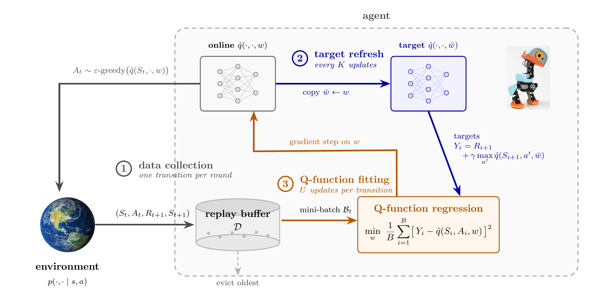

# Deep Reinforcement Learning

[](https://www.python.org/)
[](https://pytorch.org/)
[](https://gymnasium.farama.org/)
[](#roadmap)
[](LICENSE)

A PyTorch reinforcement learning library built from mathematical derivations
to explicit learning algorithms and runnable experiments.

The code keeps objectives, estimators, gradient updates, and environment
interaction visible. Task-specific networks and settings live with each example;
the learning algorithms, buffers, evaluation, and checkpoint handling live in
the library. The aim is to make the same implementation useful for studying an
algorithm and training a policy.

On-policy implementations and discrete/continuous-control PPO examples are
available. DQN and Double DQN are the current implementation focus.

> **Active development:** Public APIs may change. Runnable examples are not
> claims of reproduced benchmarks or optimal policies.

## Algorithms

### On-Policy Optimization (Implemented)

- [One-step actor-critic](src/deeprl/algorithms/one_step_actor_critic.py) ([Actor-Critic](mathematical_derivations/18_Actor-Critic.pdf), [baseline](mathematical_derivations/19_Actor-Critic-with-a-Baseline.pdf))
- [A2C](src/deeprl/algorithms/a2c.py) ([GAE Actor-Critic](mathematical_derivations/20_GAE_Actor-Critic.pdf))
- [Natural Policy Gradient](src/deeprl/algorithms/npg.py) ([derivation](mathematical_derivations/21_Natural-Policy-Gradient.pdf))
- [TRPO](src/deeprl/algorithms/trpo.py) ([derivation](mathematical_derivations/22_Trust-Region-Policy-Optimization.pdf))
- [PPO-Clip](src/deeprl/algorithms/ppo.py) ([derivation](mathematical_derivations/23_Proximal-Policy-Optimization.pdf))

A2C, NPG, TRPO, and PPO use the shared rollout trainer. One-step actor-critic is
a separate educational implementation.

### Off-Policy Learning (In Development)

- **DQN:** [derivation](mathematical_derivations/24_Deep-Q-Network.pdf); implementation in progress
- **Double DQN:** [derivation](mathematical_derivations/25_Double-DQN.pdf); implementation in progress
- **DDPG:** [Deterministic Policy Gradient](mathematical_derivations/26_Deterministic-Policy-Gradient.pdf) and [DDPG](mathematical_derivations/27_Deep-Deterministic-Policy-Gradient.pdf) derivations complete

## Quickstart

Python 3.12 or later is required. Dependencies are managed with
[uv](https://docs.astral.sh/uv/). Run these commands from the repository checkout.

```bash
git clone https://github.com/SaiSampathKedari/Deep-Reinforcement-Learning.git
cd Deep-Reinforcement-Learning
uv sync --extra tb --extra video

uv run python -m examples.gymnasium.cartpole.run_cartpole_ppo \
  --output-dir outputs/gymnasium/cartpole/ppo/seed_0/run_01
```

This trains PPO on **CartPole-v1** on CPU with eight environments and 102,400
transitions. Choose a new output directory for each run. The run saves its
configuration, JSONL metrics, TensorBoard events, and checkpoints.

Evaluate the final saved policy:

```bash
uv run python -m examples.gymnasium.cartpole.evaluate_cartpole \
  outputs/gymnasium/cartpole/ppo/seed_0/run_01/checkpoints/last.pt \
  --episodes 10 --seed 20000 --mode deterministic
```

View the training and evaluation curves:

```bash
uv run tensorboard --logdir outputs/gymnasium/cartpole/ppo/seed_0/run_01/events
```

See the [CartPole guide](examples/gymnasium/cartpole/README.md) for video
recording, interactive rendering, and continuation from a checkpoint. The
`tb` and `video` extras are optional; `uv sync` installs the base training setup.

## Environment Examples

Each task keeps its networks, configuration, training entry point, and evaluator
together. The examples call the shared library rather than reimplementing PPO.

- [CartPole-v1](examples/gymnasium/cartpole/README.md): discrete actions and a CPU starting point.
- [InvertedPendulum-v5](examples/gymnasium/inverted_pendulum/): Gaussian policy for continuous control.
- [Hopper-v5](examples/gymnasium/hopper/): continuous-action locomotion.
- [Humanoid-v5](examples/gymnasium/humanoid/README.md): higher-dimensional control, normalization, and a documented reference recipe.

For the MuJoCo examples, install the additional environment dependencies:

```bash
uv sync --extra mujoco --extra tb --extra video
```

CUDA can train the networks; these Gymnasium MuJoCo environments run their
physics on CPU. Each recipe specifies its settings and evaluation procedure.
Multi-seed comparisons, confidence intervals, and ablation results remain
benchmark work, separate from having a runnable example.

## Library Structure

- **Learning rules:** [algorithms/](src/deeprl/algorithms/) contains configs, losses, and parameter updates. Learners use native PyTorch optimizers; NPG/TRPO perform their actor updates directly.
- **Training lifecycle:** [train_on_policy.py](src/deeprl/training/train_on_policy.py) coordinates collection, GAE, updates, evaluation, and checkpoint timing.
- **Data and targets:** [buffers.py](src/deeprl/buffers.py), [rollouts.py](src/deeprl/rollouts.py), and [advantages.py](src/deeprl/advantages.py) separate storage, interaction, and advantage estimation.
- **Networks and preprocessing:** [policies.py](src/deeprl/policies.py) and [value.py](src/deeprl/value.py) wrap caller-supplied networks; [normalization.py](src/deeprl/normalization.py) provides explicit running statistics. Architectures stay with the task examples.
- **Evaluation and logging:** [evaluate.py](src/deeprl/evaluate.py) and [logger.py](src/deeprl/logger.py) handle policy assessment, episode statistics, JSONL metrics, and optional TensorBoard output.
- **State and continuation:** [learner_state.py](src/deeprl/learner_state.py), [checkpoint.py](src/deeprl/checkpoint.py), and [lifecycle.py](src/deeprl/lifecycle.py) handle native state dictionaries, resume checks, configuration, Torch RNG state, and provenance.

Rollout buffers preserve the time/environment layout `(T, N)`. Replay buffers
use flat FIFO transition storage. Both support fixed-shape tensors and
TensorDict data; structured storage does not automatically make a policy support
every observation or action space.

Import the shared on-policy components through:

```python
from deeprl.algorithms.ppo import PPOConfig, PPOLearner
from deeprl.training.train_on_policy import train_on_policy
```

The [CartPole training script](examples/gymnasium/cartpole/run_cartpole_ppo.py)
shows the complete assembly: environments, networks, learner, logger, evaluator,
and training call. The learner contract is in `deeprl.algorithms.on_policy`.
These are the only on-policy import paths; there are no compatibility shims.

### Checkpoints and Evaluation

The rollout trainer saves `last.pt` and periodic `step_<transitions>.pt` files
at completed-update boundaries. Checkpoints include learner/optimizer state,
trainer-managed preprocessing state, progress, supported Torch RNG state,
configuration, and informational dependency/source provenance. Only the current
checkpoint contract is supported, without schema versions, migrations, or legacy
fallbacks. There is no automatic best-checkpoint selection.

Resume restores learning state but starts **fresh environment episodes**;
it does not restore the simulator's exact trajectory. Evaluation uses frozen
preprocessing statistics and reports raw, undiscounted episode returns.
Deterministic and stochastic evaluations are reported separately.

The [one-step CartPole tutorial](examples/gymnasium/cartpole/run_cartpole_one_step_actor_critic.py)
is intentionally separate: it exports inference weights, without the shared
trainer's checkpoint/resume contract.

## From Derivations to Systems

The derivations are working specifications for the implementation. They determine
what the buffers preserve, where gradients stop, and which quantities remain
fixed during an update. This is visible in termination-aware GAE, fixed old-policy
log probabilities in PPO, matrix-free Fisher products, and TRPO's parameter
rollback.

The DQN derivation separates generalized Q-learning into data collection,
target-network refresh, and Q-function fitting. These independently scheduled
operations guide the next off-policy implementation.

[](mathematical_derivations/24_Deep-Q-Network.pdf)

[Browse the mathematical derivations](mathematical_derivations/README.md).
Their numbering follows a shared reading sequence with
[Reinforcement Learning](https://github.com/SaiSampathKedari/Reinforcement-Learning/tree/master/mathematical_derivations).
Reports 13-20 cover policy-gradient and actor-critic foundations; 21-27 cover
NPG, TRPO, PPO, DQN, Double DQN, deterministic policy gradients, and DDPG.

## Roadmap

**Now:** Implement and validate DQN and Double DQN with a separate off-policy training loop.

**Next:** DDPG, TD3, SAC, and multi-seed Gymnasium and MuJoCo benchmarks.

**Longer term:** Offline RL, imitation learning, model-based RL and world models,
richer policy architectures, robotics integration, and VLA post-training.

## Related Repositories

- **Mathematical foundations:** [Real Analysis](https://github.com/SaiSampathKedari/Real-Analysis) | [Probability and Distribution Theory](https://github.com/SaiSampathKedari/Probability-and-Distribution-Theory) | [Statistical Inference Theory](https://github.com/SaiSampathKedari/Statistical-Inference-Theory)
- **Sequential-decision theory:** [Sequential Decision Making](https://github.com/SaiSampathKedari/Sequential-Decision-Making)
- **Classical reinforcement learning:** [Reinforcement Learning](https://github.com/SaiSampathKedari/Reinforcement-Learning)

## Contact

- Email: [sampath@umich.edu](mailto:sampath@umich.edu)
- LinkedIn: [Sai Sampath Kedari](https://www.linkedin.com/in/sai-sampath-kedari)

## License

Released under the [MIT License](LICENSE).
